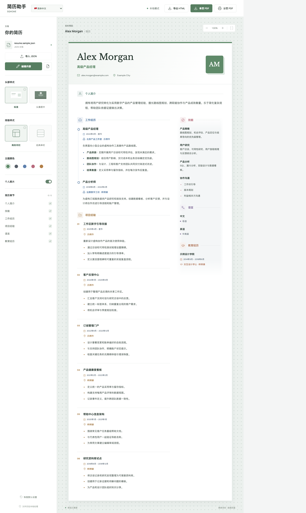
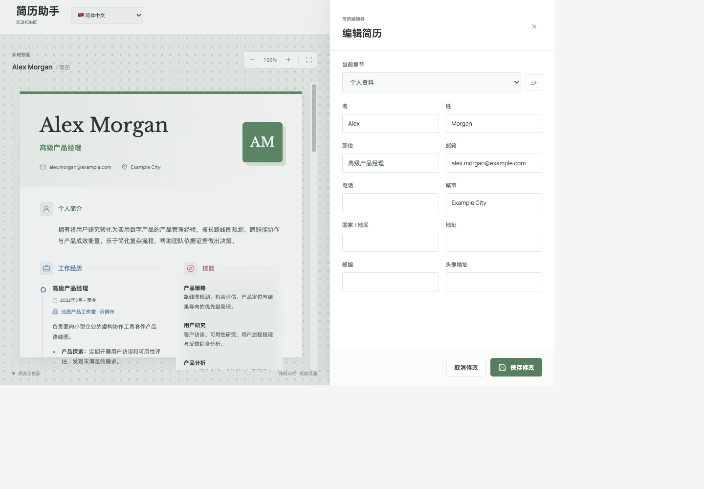

# 이력서 도우미

[简体中文](README.md) · [English](README.en.md) · [日本語](README.ja.md) · [한국어](README.ko.md) · [Español](README.es.md) · [Français](README.fr.md)

SQHOME의 로컬 이력서 레이아웃 및 내보내기 도구입니다. 지원되는 이력서 JSON을 브라우저에서 렌더링하며 백엔드는 필요하지 않습니다. 기본으로 다국어 샘플 이력서가 열립니다.

## 기능

- 비즈니스 2단 및 클래식 1단 레이아웃, 기본형 및 중앙 아바타 헤더.
- 중국어 간체, 영어, 일본어, 한국어, 스페인어, 프랑스어 등 6개 인터페이스 언어.
- 내장 샘플을 바로 편집하거나 본인의 JSON을 가져올 수 있습니다. 변경 사항은 실시간 미리보기에 반영되고 현재 페이지 메모리에 보관됩니다.
- HTML, 수정된 JSON, 한 페이지 PDF, 브라우저 기본 페이지 나눔 PDF 내보내기.
- 섹션 표시 설정, 테마 색상, 사진 표시, 미리보기 확대/축소.

### 화면 미리보기

**이력서 작업 화면**



**이력서 편집기**



## 로컬 실행

Node.js 18 이상이 필요합니다.

```sh
npm install
npm run dev
```

Vite가 출력하는 로컬 URL을 엽니다. `npm test`와 `npm run build`로 테스트 및 빌드를 실행합니다.

## 샘플 이력서 편집

앱을 열면 다국어 샘플이 표시되며 바로 편집할 수 있습니다. **내용 편집**을 선택하고 수정한 다음 저장하세요. **JSON 다운로드**로 개인 사본을 저장할 수 있습니다. 샘플 사용 중 언어를 바꾸면 해당 언어의 원본 샘플로 전환됩니다. 본인의 JSON을 가져온 뒤에는 언어를 바꿔도 이력서 내용이 교체되지 않습니다.

## Resume.io JSON 가져오기

로그인된 Resume.io 브라우저 세션에서 본인 이력서의 JSON을 가져올 수 있습니다.

1. [Resume.io](https://resume.io/)에 로그인합니다.
2. 같은 브라우저 세션에서 [`https://resume.io/api/app/resumes`](https://resume.io/api/app/resumes)를 열고 대상 이력서의 `id`를 확인합니다.
3. `{id}`를 해당 값으로 바꿔 `https://resume.io/api/app/resumes/{id}`를 엽니다. 응답에 이력서 JSON이 표시됩니다.
4. 응답을 `resume.json`으로 저장한 뒤 앱에서 **JSON 가져오기**를 선택합니다.

이 API는 현재 로그인 세션을 사용합니다. 개인정보나 계정 메타데이터가 포함된 응답 파일을 공유하지 마세요. `renderingToken`만으로는 이력서를 복원할 수 없으며 Resume.io 이미지 엔드포인트는 첫 페이지만 제공합니다.

`firstName`, `lastName`, `position`, `profile`, `workExperiences`, `educations`, `skills`, `languages`, `customSections`, `sectionsOrder` 등의 필드를 지원합니다. 전체 구조는 [`examples/resume.sample.json`](examples/resume.sample.json)을 참고하세요.

## PDF 안내

한 페이지 PDF는 전체 이력서를 A4 한 장에 맞추므로 내용이 길면 글자가 작아집니다. 페이지 나눔 PDF는 브라우저 기본 인쇄 기능을 사용합니다. 파일명은 이름, 직무, `Resume`, 날짜로 구성됩니다. 한 페이지 PDF의 텍스트는 이미지로 저장되어 선택할 수 없습니다.

모든 처리는 브라우저에서 이루어집니다. 아바타 URL을 표시하려면 인터넷 연결이 필요합니다. JSON을 공유하기 전에 내용을 확인하세요. 수정된 JSON에는 원본의 알 수 없는 필드도 보존됩니다.

## 라이선스

[MIT License](LICENSE). 종속성 및 폰트는 각 라이선스를 따릅니다. SQHOME 이름과 브랜드 사용권은 포함되지 않습니다.
